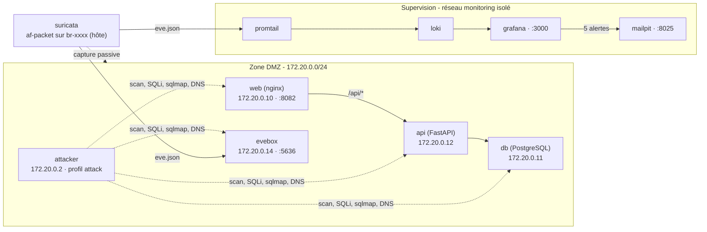

# Suricata NDR - DMZ

Détection d'intrusions réseau (NIDS/NDR) avec **Suricata** et **EveBox** sur une zone DMZ simulée, supervisée par **Promtail, Loki, Grafana et Mailpit**. Déployable en trois commandes avec Docker Compose.

<sub>IFRI - Université d'Abomey-Calavi · Licence 3 Sécurité Informatique · Outils de monitoring 2026-2027 · Groupe 2</sub>

<p align="center">
  
  
  
  
  
  
  
  
  
</p>

---

## Architecture



> Le réseau `monitoring` est isolé de `dmz` : Suricata n'observe pas le trafic Promtail → Loki (évitant toute boucle d'auto-alerte).

## Démarrage rapide (3 commandes)

**Prérequis :** Docker 24+, Docker Compose v2, ~2 Go de RAM, Linux ou WSL2.

```bash
git clone https://github.com/VISCHENZISCH/suricata-ndr-dmz.git && cd suricata-ndr-dmz
cp .env.example .env   # définir des mots de passe forts (DB, EveBox, Grafana)
docker compose up -d --build
```

**Mise à jour ET Open et scénario d'attaque :**

```bash
./suricata/update-rules.sh             # met à jour ET Open + recharge à chaud
docker compose build attacker          # construit le poste attaquant (profil attack)
docker compose run --rm attacker       # options : --no-pause, --fast, --interactive
```

## Services déployés

| Service | Rôle | Réseau / IP | Accès hôte |
|---|---|---|---|
| `web` | Portail Nginx et reverse proxy `/api/` | `dmz` (`172.20.0.10`) | http://127.0.0.1:8082 |
| `db` | PostgreSQL 16 (`g2db`) | `dmz` (`172.20.0.11`) | Interne DMZ |
| `api` | API FastAPI (auth, sessions, `/api/health`) | `dmz` (`172.20.0.12`) | Interne DMZ |
| `evebox` | Console d'alertes SQLite (rétention 7 j) | `dmz` (`172.20.0.14`) | http://127.0.0.1:5636 |
| `suricata` | Sonde NDR (`af-packet` sur bridge DMZ) | Pile réseau hôte | `suricatasc` (socket UNIX) |
| `loki` / `promtail` | Indexation et collecte de `eve.json` | `monitoring` | Interne |
| `grafana` | Dashboards (2) + alerting (5 règles) | `monitoring` | http://127.0.0.1:3000 |
| `mailpit` | Boîte SMTP des alertes (`soc@g2.local`) | `monitoring` | http://127.0.0.1:8025 |
| `attacker` | Poste d'attaque (`nmap`, `curl`, `dig`, `sqlmap`) | `dmz` (`172.20.0.2`) | `docker compose run --rm attacker` |

Tous les comptes (PostgreSQL, EveBox, Grafana) sont configurés via `.env` — aucun identifiant par défaut.

## Détection, supervision & scénario

- **Portail & EveBox** : sessions par cookie `HttpOnly`, mots de passe salés dans PostgreSQL, utilisateur EveBox créé au 1er démarrage par `evebox/entrypoint.sh`.
- **Sonde Suricata (`suricata/`)** : `entrypoint.sh` repère le bridge `br-xxxx` par la passerelle `172.20.0.1`, active `promisc on` et lance Suricata sous `--user suricata`. `HOME_NET` cible uniquement `.10`, `.11`, `.12`, `.14` pour que `attacker` (`.2`) reste dans `$EXTERNAL_NET`. `tpacket-v3: no` et `default-packet-size: 65535` assurent la capture inter-conteneurs sans faux positifs `AF-PACKET truncated packet`.
- **5 règles custom (`suricata/rules/local.rules`)** + jeu ET Open (~53 600 règles) :
  `2000001` (SQLi URI), `2000002` (User-Agent offensif), `2000003` (volume DNS `>= 30` req/10 s), `2000004` (label DNS `>= 40` car.), `2000005` (domaines tunnel : ngrok, duckdns, no-ip…).

**Dashboards Grafana (`grafana/dashboards/`) :**
- **Suricata - Vue Direction** (`direction.json`, 7 panneaux) : alertes sur période, SLO sév. 1 (`cible = 0`), santé/disponibilité sonde, répartition par sévérité, Top 10 attaquants, évolution.
- **Suricata - Vue Exploitation** (`exploitation.json`, 8 panneaux) : alertes/top signatures, flux DNS & HTTP, codes HTTP (RED), top domaines DNS, paquets capturés vs perdus (`kernel_packets`/`kernel_drops`, méthode USE), logs bruts.

**Alerting (`grafana/provisioning/alerting/alerts.yaml` → Mailpit `soc@g2.local`) :**

| Type | Règle | Seuil & fenêtre (`for`) | Sévérité |
|---|---|---|---|
| Infra | Sonde Suricata silencieuse | `absent_over_time({job="suricata"}[2m]) > 0` (`1m`) | Critical |
| Infra | Paquets perdus (`kernel_drops`) | `> 1 %` (`5m`) | Warning |
| Sécu | Scan de ports / reconnaissance | `> 3` alertes `ET SCAN` en `1m` (`30s`) | High |
| Sécu | Attaque critique sév. 1 | `>= 1` alerte `severity="1"` en `1m` (`0s`) | Critical |
| Sécu | Tunnel / volume DNS anormal | `>= 1` alerte DNS G2 (`2000003`/`2000004`) en `1m` (`30s`) | Warning |

**Scénario d'attaque (`attacker/scenario.sh`, garde-fou RFC 1918) :**
1. `nmap -sS` (top 200 ports) puis `nmap -sV` (`80`, `8000`, `5432`, `5636`)
2. SQLi (`UNION SELECT`, `OR '1'='1'`) et traversal (`/../../../../etc/passwd`, `%2e%2e%2f`)
3. `sqlmap --batch --ignore-code=401 --flush-session` sur `/api/me?id=1`
4. User-Agent offensifs (`sqlmap`, `nikto`, `gobuster`)
5. Tunnel DNS : 40 sous-domaines aléatoires de 48 car. hex (`15` avec `--fast`) + domaines relais (`ngrok.io`, `duckdns.org`, `no-ip.org`)
6. Vérification côté sonde (filtres EveBox, `eve.json`, Grafana, Mailpit)

## Durcissement

- **Secrets** dans `.env` (ignoré par Git, modèle `.env.example`) ; accès anonyme et inscription désactivés dans Grafana.
- **Exposition** limitée à `127.0.0.1` (`8082`, `5636`, `3000`, `8025`) ; `api`, `db`, `loki`, `promtail` non publiés.
- **Privilèges & FS** : images épinglées, `no-new-privileges: true` partout, `cap_drop: [ALL]` sur `loki`/`promtail`/`grafana`, `read_only: true` sur `web`/`api`/`loki`/`promtail`/`attacker`, `apiuser` non-root, healthchecks sur `web`/`api`/`db`/`evebox`/`suricata`.

## Structure du dépôt

```
├── docker-compose.yml       orchestration (dmz, monitoring, profil attack)
├── .env.example             modèle des variables d'environnement
├── dmz/{web,api,db}         Nginx + frontend, FastAPI, schéma PostgreSQL
├── evebox/                  evebox.yaml + entrypoint.sh
├── suricata/                suricata.yaml, rules/local.rules, Dockerfile, entrypoint.sh, update-rules.sh
├── attacker/                Dockerfile (nmap, curl, dig, sqlmap) + scenario.sh
├── loki/ & promtail/        stockage et collecte de eve.json
├── grafana/                 provisioning (datasource, 5 alertes) + 2 dashboards JSON
└── docs/                    cahier des charges PDF, guide et ressources
```

## Feuille de route

- [x] Zone DMZ (`web`, `api`, `db`) + authentification
- [x] Console `evebox` (SQLite, auth `.env`)
- [x] Sonde `suricata` (`af-packet`, 5 règles custom, ET Open)
- [x] Dashboards `Grafana` + `Loki` (Direction & Exploitation USE/RED)
- [x] Alerting Grafana (5 règles) + notifications `Mailpit`
- [x] Conteneur `attacker` et scénario 6 étapes (`sqlmap` inclus)
- [ ] Rapport technique (15-20 p. PDF) et soutenance (25 min)

## Équipe

| Rôle | Membre |
|---|---|
| Architecte Déploiement, DevSecOps, IaC (chef d'équipe) | TOVIGNAN Kouassi Félix |
| Spécialiste Sécurisation et Durcissement | KPEGBE Uriel |
| Spécialiste Collecte, Ingestion et Sondes | AGBO Ognankitan Eliézer |
| Spécialiste Métrologie et Dashboards | AVOCETIEN Karol |
| Responsable Alerting et Notifications | DIMON Anaël |
| Spécialiste Détection et Scénarios d'Attaque | OKPEIFA Yves Dieudonné |

Enseignant : M. Abousidikou ODJO · *Projet à but pédagogique : n'exécuter les attaques que dans cet environnement isolé.*
