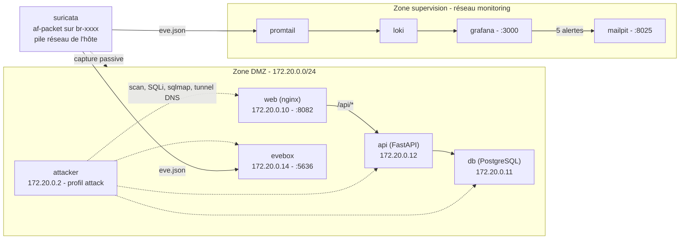

# Suricata NDR - DMZ

Détection d'intrusions réseau (NIDS/NDR) avec **Suricata** et **EveBox** sur une zone DMZ simulée, supervisée par **Loki, Grafana et Mailpit**. Déploiement en trois commandes avec Docker Compose.

IFRI - Université d'Abomey-Calavi | Licence 3 Sécurité Informatique | Outils de monitoring 2026-2027 | Groupe 2

<p align="center">
  
  
  
  
  
  
  
  
  
</p>

---

## Table des matières

1. [Aperçu](#aperçu)
2. [Architecture](#architecture)
3. [Démarrage rapide](#démarrage-rapide)
4. [Services déployés](#services-déployés)
5. [Détail des composants](#détail-des-composants)
6. [Durcissement](#durcissement)
7. [Structure du dépôt](#structure-du-dépôt)
8. [Feuille de route](#feuille-de-route)
9. [Équipe](#équipe)
10. [Avertissement](#avertissement)

---

## Aperçu

Le projet déploie une zone DMZ simulée (`172.20.0.0/24`) composée d'un portail web Nginx, d'une API FastAPI interne et d'une base PostgreSQL. Elle est observée par une sonde **Suricata** (capture `af-packet`) dont les alertes sont consultables dans **EveBox**.

Une pile d'observabilité **Promtail, Loki, Grafana**, provisionnée en code, fournit :

- deux tableaux de bord : *Vue Direction* et *Vue Exploitation* ;
- cinq règles d'alerte notifiées par e-mail via **Mailpit**.

Un conteneur **attacker** rejoue un scénario d'attaque en six étapes pour valider la chaîne de détection de bout en bout.

## Architecture



**Lecture du schéma**

| Type de flux | Représentation |
|---|---|
| Trafic applicatif | Trait plein dans la DMZ (`web`, `api`, `db`) |
| Trafic d'attaque | Pointillés depuis `attacker` |
| Capture réseau | Pointillés depuis `suricata` (mode passif : IDS, aucun blocage) |
| Logs `eve.json` | Traits pleins vers `evebox` et `promtail` |
| Alertes | De `grafana` vers `mailpit` |

La zone de supervision est isolée sur un réseau `monitoring` distinct : la sonde n'observe donc pas les flux d'ingestion Promtail vers Loki, ce qui évite toute boucle d'auto-détection.

## Démarrage rapide

**Prérequis :** Docker 24+, Docker Compose v2, environ 2 Go de RAM libres, Linux ou WSL2.

```bash
git clone https://github.com/VISCHENZISCH/suricata-ndr-dmz.git && cd suricata-ndr-dmz
cp .env.example .env   # puis définir des mots de passe forts pour DB, EveBox et Grafana
docker compose up -d --build
```

**Mise à jour des règles ET Open et lancement du scénario d'attaque (optionnel) :**

```bash
./suricata/update-rules.sh             # met à jour ET Open et recharge la sonde à chaud
docker compose build attacker          # construit le conteneur offensif (profil "attack")
docker compose run --rm attacker       # lance la démonstration guidée pas à pas
```

Options de `attacker` :

| Option | Effet |
|---|---|
| `--no-pause` | Répétition automatisée, sans pause |
| `--fast` | 15 requêtes DNS au lieu de 40 |
| `--interactive` | Attente d'Entrée entre les étapes |

**Accès aux interfaces (depuis l'hôte uniquement) :**

| Interface | URL |
|---|---|
| Portail web | http://127.0.0.1:8082 |
| EveBox | http://127.0.0.1:5636 |
| Grafana | http://127.0.0.1:3000 |
| Mailpit | http://127.0.0.1:8025 |

## Services déployés

| Service | Rôle | Réseau / IP | Accès hôte |
|---|---|---|---|
| `web` | Portail Nginx et reverse proxy `/api/` | `dmz` (`172.20.0.10`) | http://127.0.0.1:8082 |
| `db` | Base PostgreSQL 16 (`g2db`) | `dmz` (`172.20.0.11`) | Réseau DMZ uniquement |
| `api` | API FastAPI (auth, sessions, santé DB) | `dmz` (`172.20.0.12`) | Réseau DMZ uniquement |
| `evebox` | Console d'alertes (SQLite) | `dmz` (`172.20.0.14`) | http://127.0.0.1:5636 |
| `suricata` | Sonde NDR (`af-packet` sur le bridge DMZ) | Pile réseau de l'hôte | `suricatasc` (socket UNIX) |
| `loki` | Stockage et indexation des logs `eve.json` | `monitoring` | Aucun |
| `promtail` | Collecte de `/var/log/suricata/eve.json` vers Loki | `monitoring` | Aucun |
| `grafana` | Dashboards Direction et Exploitation, 5 alertes | `monitoring` | http://127.0.0.1:3000 |
| `mailpit` | Boîte SMTP des alertes (`soc@g2.local`) | `monitoring` | http://127.0.0.1:8025 |
| `attacker` | Poste d'attaque (nmap, curl, dig, sqlmap) | `dmz` (`172.20.0.2`) | `docker compose run --rm attacker` |

Tous les identifiants (PostgreSQL, EveBox, Grafana) sont définis dans `.env` : aucun compte par défaut n'est utilisé.

## Détail des composants

### Portail web (`web` et `api`)

- Inscription (`/register.html` vers `POST /api/register`) et connexion (`/login.html` vers `POST /api/login`), stockées dans PostgreSQL (`users`) avec mots de passe salés et requêtes SQL paramétrées.
- Session par cookie `HttpOnly` (`SameSite=Lax`). `dashboard.html` redirige vers `login.html` si l'utilisateur n'est pas authentifié et affiche son e-mail dans la barre de navigation.

### Console d'alertes (`evebox`)

- Backend SQLite léger, rétention de 7 jours (`evebox/evebox.yaml`).
- Utilisateur créé au premier démarrage par `evebox/entrypoint.sh`, à partir de `EVEBOX_USER` et `EVEBOX_PASSWORD` (`.env`).

### Sonde NDR (`suricata`)

**Capture**

- Capture `af-packet` sur le bridge Docker de la DMZ. Le conteneur partage la pile réseau de l'hôte (`network_mode: host`) : un conteneur branché sur le bridge ne verrait que son propre trafic, le bridge commutant port par port.
- `suricata/entrypoint.sh` localise l'interface `br-xxxx` via la passerelle `172.20.0.1` et la passe en mode **promiscuous** (sans quoi le noyau ne remonte que le multicast adressé au bridge, jamais le trafic entre conteneurs). Il nettoie un éventuel ancien PID, puis lance Suricata sous l'utilisateur `suricata`. Le mode promiscuous est retiré à l'arrêt.
- `default-packet-size: 65535` et `tpacket-v3: no` (`suricata/suricata.yaml`) donnent une capture fiable sur bridge Linux et éliminent les faux positifs `SURICATA AF-PACKET truncated packet` liés au GSO/GRO.

**Périmètre de détection**

- `HOME_NET` désigne les quatre cibles de la DMZ (`172.20.0.10`, `.11`, `.12`, `.14`) et non le sous-réseau entier. `attacker` (`172.20.0.2`) reste dans `$EXTERNAL_NET`, ce qui déclenche les règles de reconnaissance.

**Règles**

| SID | Détection |
|---|---|
| `2000001` | Injection SQL dans l'URI |
| `2000002` | User-Agent d'outil offensif |
| `2000003` | Volume DNS anormal (`>= 30` requêtes / 10 s) |
| `2000004` | Label DNS très long (`>= 40` caractères) |
| `2000005` | Requête vers un domaine de tunnel (ngrok, DuckDNS, no-ip, etc.) |

Les règles locales sont dans `suricata/rules/local.rules`. `suricata/update-rules.sh` récupère ET Open via `suricata-update` et recharge la sonde à chaud (`suricatasc -c reload-rules`). Le jeu ET Open livré avec l'image `7.0.17` est actif dès le démarrage. Les événements JSON sont écrits dans `eve.json`, sur le volume partagé `suricata-logs`.

### Supervision et alerting (`promtail`, `loki`, `grafana`, `mailpit`)

**Tableaux de bord** (provisionnés en code dans `grafana/dashboards/`)

| Dashboard | Fichier | Panneaux | Contenu |
|---|---|---|---|
| Suricata - Vue Direction | `direction.json` | 7 | Total d'alertes, alertes critiques sév. 1 (cible SLO = 0), disponibilité de la sonde (`OK` / `HORS LIGNE`), volume d'événements analysés, répartition par sévérité, Top 10 des attaquants (IP source), évolution temporelle |
| Suricata - Vue Exploitation | `exploitation.json` | 8 | Alertes par signature, top signatures, flux DNS/min et HTTP/min, codes HTTP (méthode RED), top domaines DNS, paquets capturés vs perdus `kernel_packets` / `kernel_drops` (méthode USE), flux brut des dernières alertes |

**Règles d'alerte** (`grafana/provisioning/alerting/alerts.yaml`, routées vers Mailpit, destinataire `soc@g2.local`)

| Type | Règle | Condition / seuil | Persistance (`for`) | Sévérité |
|---|---|---|---|---|
| Infra | Sonde Suricata silencieuse | `absent_over_time({job="suricata"}[2m]) > 0` | `1m` | Critical |
| Infra | Paquets perdus par Suricata | `kernel_drops / kernel_packets > 1 %` | `5m` | Warning |
| Sécu | Scan de ports / reconnaissance Nmap | `> 3` alertes `ET SCAN` en `1m` | `30s` | High |
| Sécu | Injection SQL / traversée de répertoires | `>= 1` alerte de `severity="1"` en `1m` | `0s` | Critical |
| Sécu | Tunnel ou volume DNS anormal | `>= 1` alerte DNS G2 (`2000003` / `2000004`) en `1m` | `30s` | Warning |

### Scénario d'attaque (`attacker`)

Conteneur Alpine minimal (`nmap` avec scripts NSE, `curl`, `dig`, `sqlmap`), branché sur la DMZ en `172.20.0.2` sous le profil Compose `attack` : il ne démarre pas avec la pile. Un garde-fou intégré refuse de cibler une adresse hors plages privées RFC 1918, sauf avec `ALLOW_NON_RFC1918=1`.

`attacker/scenario.sh` déroule six étapes (cinq offensives, une de vérification), avec des pauses pour commenter en direct :

| Étape | Nom | Actions |
|---|---|---|
| 1 | Reconnaissance | `nmap -sS` (200 ports principaux sur les 4 cibles), puis `nmap -sV` (ports `80`, `8000`, `5432`, `5636`) |
| 2 | Injection SQL et traversée manuelles | `?id=1' UNION SELECT ...`, `?id=1' OR '1'='1`, `/../../../../etc/passwd` et forme encodée `%2e%2e%2f` |
| 3 | Injection SQL automatisée | `sqlmap --batch --ignore-code=401 --flush-session` contre `/api/me?id=1` |
| 4 | Outils offensifs par User-Agent | Requêtes `curl` avec les en-têtes `sqlmap/1.8.2#stable`, `nikto/2.1.6` et `gobuster/3.6` |
| 5 | Tunnel DNS simulé | Rafale de 40 sous-domaines aléatoires de 48 caractères hex (`*.exfil.example`, 15 avec `--fast`), puis requêtes vers `tunnel.ngrok.io`, `atelier.duckdns.org` et `relais.no-ip.org` |
| 6 | Vérification côté sonde | Rappel des filtres EveBox (`alert.signature_id:2000001` à `2000005`), commandes `eve.json`, Grafana et Mailpit |

## Durcissement

| Axe | Mesures |
|---|---|
| Secrets | Aucun mot de passe par défaut. Secrets dans `.env` (exclu via `.gitignore`, modèle dans `.env.example`) |
| Exposition | Ports publiés uniquement sur `127.0.0.1` (`8082` web, `5636` evebox, `3000` grafana, `8025` mailpit). `api`, `db`, `loki` et `promtail` non exposés à l'hôte. Inscription publique et accès anonyme désactivés dans Grafana |
| Versions | Images épinglées : `nginx:1.27-alpine`, `postgres:16-alpine`, `python:3.12-slim`, `jasonish/suricata:7.0.17`, `jasonish/evebox:0.32.0`, `grafana/loki:3.2.0`, `grafana/promtail:3.2.0`, `grafana/grafana:11.3.0`, `axllent/mailpit:v1.21`, `alpine:3.20` |
| Privilèges | `no-new-privileges: true` sur tous les services. `cap_drop: [ALL]` sur `loki`, `promtail`, `grafana`. Utilisateur non-root `apiuser` (`10001`) dans `api`, `--user suricata` dans `suricata` |
| Système de fichiers | `read_only: true` sur `web`, `api`, `loki`, `promtail`, `attacker` |
| Supervision | Healthchecks sur `web`, `api`, `db`, `evebox` et `suricata` |

## Structure du dépôt

```
.
├── docker-compose.yml       orchestration (réseaux dmz et monitoring, profil attack)
├── .env.example             modèle des variables d'environnement
├── dmz/
│   ├── web/                 frontend HTML/CSS/JS et nginx.conf (reverse proxy)
│   ├── api/                 API FastAPI (Dockerfile, requirements.txt, app/main.py)
│   └── db/                  init.sql (schéma PostgreSQL)
├── evebox/                  evebox.yaml et entrypoint.sh (SQLite, authentification)
├── suricata/                suricata.yaml, rules/local.rules, Dockerfile,
│                            entrypoint.sh, update-rules.sh
├── attacker/                Dockerfile (nmap, curl, dig, sqlmap) et scenario.sh
├── loki/                    loki.yaml
├── promtail/                promtail.yaml (scrape de eve.json)
├── grafana/
│   ├── provisioning/        datasource Loki, alerting (5 règles), dashboard provider
│   └── dashboards/          direction.json, exploitation.json
├── notifications/           réservé (alerting assuré via Grafana et Mailpit)
└── docs/                    cahier des charges PDF, guide de finalisation, ressources
```

## Feuille de route

- [x] Zone DMZ applicative (`web`, `api`, `db`) avec reverse proxy et authentification
- [x] Console d'alertes `evebox` (SQLite, authentification depuis `.env`)
- [x] Sonde NIDS `suricata` (5 règles custom, ET Open, capture `af-packet` validée, aucun bruit `AF-PACKET truncated`)
- [x] Dashboards `Grafana` et `Loki` (Vue Direction et Vue Exploitation, méthodes USE/RED), provisionnés en code
- [x] Alerting Grafana (2 infra, 3 sécu) et notifications e-mail via `Mailpit`
- [x] Conteneur `attacker` et scénario d'attaque (`scenario.sh`, 6 étapes dont `sqlmap`)
- [ ] Rapport technique (15 à 20 pages PDF) et répétition de la soutenance (25 min)

## Équipe

| Rôle | Membre |
|---|---|
| Architecte Déploiement, DevSecOps, IaC (chef d'équipe) | TOVIGNAN Kouassi Félix |
| Spécialiste Sécurisation et Durcissement | KPEGBE Uriel |
| Spécialiste Collecte, Ingestion et Sondes | AGBO Ognankitan Eliézer |
| Spécialiste Métrologie et Dashboards | AVOCETIEN Karol |
| Responsable Alerting et Notifications | DIMON Anaël |
| Spécialiste Détection et Scénarios d'Attaque | OKPEIFA Yves Dieudonné |

Enseignant : M. Abousidikou ODJO

## Avertissement

Projet à but pédagogique. Les attaques simulées ne doivent être exécutées que contre l'environnement isolé de ce dépôt, jamais contre des systèmes tiers.